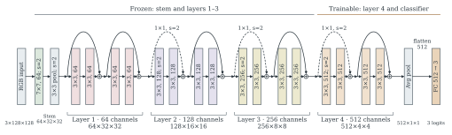
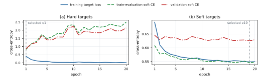

# Vote-distribution supervision for Galaxy Zoo morphology

## Research Background

Galaxy morphology supports studies of galaxy evolution and structure. GZ2
collects multiple volunteer responses per image, so an argmax label discards
disagreement. Disagreement may reflect observation limits, intermediate
morphology or annotator differences; vote entropy alone is not causal evidence.
Raw fractions are responses, not physical truth, and `star or artifact` is the
root screening class rather than a third galaxy morphology. The question is
whether retaining votes improves probability fitting without obscuring the
classification trade-off.

## Methodology

The model is ImageNet-pretrained ResNet-18 with 128-pixel bilinear RGB input,
ImageNet normalization, batch size 32, Adam, learning rate `3e-4`, weight decay
`1e-4`, and only `layer4` plus the linear classifier unfrozen. Hard targets are
one-hot argmax labels; soft targets are normalized raw vote fractions. The
128-pixel choice follows measured CPU throughput (65.72 versus 29.44 samples/s
at 224 px). The soft-only search varied learning rate `{1e-4, 3e-4}`, weight
decay `{0, 1e-4}`, and head-only versus layer4+head; validation soft CE
selected the common configuration, with calibration discrepancy and earliest
epoch only as tie-breakers.

*Figure 1. ResNet-18 shared by hard and soft supervision. Solid shortcuts are
identities; dashed shortcuts are 1×1 stride-2 projections. Unmarked
convolutions have stride 1. Global average pooling is followed by flattening
and a 512-to-3 linear classifier. Batch normalization and ReLU are omitted for
clarity.*

## Results and Discussion

Under the fixed-budget evaluation protocol in `configs/formal.json`, with
training sizes 3,100 and 10,000, fixed 750-object validation split and a
10,000-object natural pool, the table reports means over three paired seeds:

| training / target | CE | Brier | accuracy |
|---|---:|---:|---:|
| mean-soft baseline | 0.7678 | 0.1676 | 0.7586 |
| hard-frequency baseline | 0.8412 | 0.1819 | 0.7586 |
| 3,100 hard | 0.8748 | 0.0880 | 0.8813 |
| 3,100 soft | 0.6156 | 0.0456 | 0.8908 |
| 10,000 hard | 0.8805 | 0.0851 | 0.8892 |
| 10,000 soft | 0.6053 | 0.0384 | 0.9034 |

The 10,000-object run also receives about 3.23 times as many updates while
class-2 remains 34 training objects, so scale and update budget are confounded.
The separate 20-epoch train/validation diagnostic used the 3,100-object
training split, fixed 750-object validation split and seed `20261119`; it is an
optimization diagnostic, not an independent evaluation:

*Figure 2. Blue is target loss: one-hot CE for hard and vote-distribution CE
for soft; green and red are train-evaluation and validation soft CE. Dotted
grey lines mark selected epochs (1 and 19); panels have independent y-scales.*

Hard training CE falls towards zero while validation soft CE rises from 0.8676
at epoch 1 to 2.1351 at epoch 20. Soft validation CE continues to improve
after epoch 3, reaching 0.6251 at epoch 19 and 0.6290 at epoch 20; the
`lr=1e-4` soft run selected epoch 11 and ended at 0.6288. The separation is
consistent with target mismatch and hard-supervision overfitting; it does not
identify learning rate as the sole cause or prove convergence.

Finite learning-rate and regularisation checks found no consistent advantage
for dropout `0.2` or `weight_decay=1e-3`. Selecting both targets by validation
soft CE answers a vote-distribution fitting question, not two separately
accuracy-optimised questions.

For the 10,000-object training condition, the natural-pool group with vote
entropy `H > 0.5462` and top-two vote margin `M <= 0.6897` contained 4,520
objects. Here `H` is the entropy of the normalized vote distribution, and `M`
is the largest minus second-largest vote fraction. Across three paired seeds,
soft versus hard means were CE `0.794` vs `1.136`, Brier `0.052` vs `0.133`,
and accuracy `0.808` vs `0.793`. This is a conditional probability-fitting
difference, not a physical or universal claim. On five `star or artifact`
objects, soft detected fewer at 3,100 but matched hard's mean at 10,000;
repeated objects preclude a population recall estimate.

The GZ2 `extra` result is an original-to-extra cross-sample generalisation under
selection shift, not cross-survey OOD validation. It uses the frozen
evaluation protocol, not the 20-epoch diagnostic. This remains a
short-budget, one-architecture study and does not establish physical-truth
calibration, universal soft-label superiority or a causal explanation of vote
disagreement.

References: Willett et al. (2013), MNRAS 435, 2835, doi:10.1093/mnras/stt1458;
Walmsley et al. (2022), MNRAS 509, 3966, doi:10.1093/mnras/stab3679; official
GZ2 data: https://data.galaxyzoo.org/.
